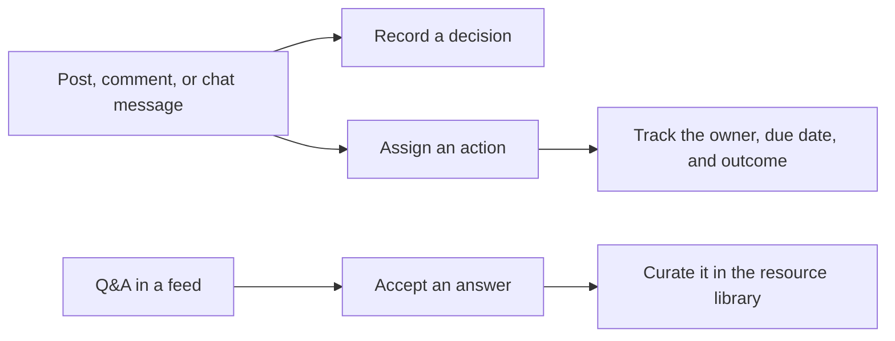
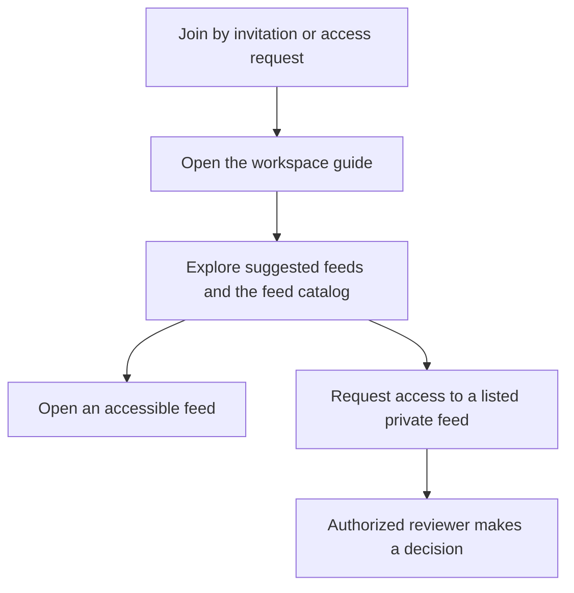

# SpectraAgora

SpectraAgora is an internal social network and digital workplace for organizations. It brings employee discussions, team messaging, events, internal recruitment, and a marketplace into one workspace. Each organization manages its own members, content, and access rules.

This repository contains the public product overview. The in-app **Help** page provides step-by-step guidance for members, moderators, and tenant administrators. Features available to a member depend on their workspace configuration, role, and deployed release.

## Contents

- [Feeds and collaboration](#feeds-and-collaboration)
- [Messaging and audio](#messaging-and-audio)
- [Events and calendar](#events-and-calendar)
- [People, careers, and recognition](#people-careers-and-recognition)
- [Internal marketplace](#internal-marketplace)
- [Workspace onboarding and administration](#workspace-onboarding-and-administration)
- [Search, notifications, and everyday use](#search-notifications-and-everyday-use)
- [Security and privacy](#security-and-privacy)
- [Help and support](#help-and-support)

## Feeds and collaboration

- **Workspace feeds** organize rich-text posts, images, videos, polls, and Q&A. Feeds can be open to the organization or restricted to eligible members and groups.
- **Discussions** support reactions, threaded replies, mentions, followed conversations, and unread markers. Members can follow or mute eligible feeds, topics, and individual discussions.
- **Knowledge sharing** includes accepted Q&A answers, similar-question suggestions, and a searchable feed resource library with curated links and tags.
- **Publishing tools** include private drafts with attachment recovery, shared team drafts with editors and a designated publisher, and scheduling for eligible text announcements. Important announcements can request acknowledgment.
- **Decisions and actions** capture outcomes from posts, comments, or messages. An action can have an assignee, a due date, and a link to the original discussion.
- **Idea board** lets members propose and vote on ideas. Authorized reviewers can move ideas through Under review, Planned, and Implemented.
- **Stories and discovery** surface temporary updates and trending topics from content the member can access.

## Messaging and audio

- **Unified inbox** brings direct and group conversations together with filters for direct messages, groups, and unread conversations.
- **Private group conversations** support participant management, chat roles, and a choice of history access for new participants.
- **Message tools** include replies, reactions, attachments, editing, deletion, read indicators, and group pins, where available. Group conversations can also contain polls and surveys.
- **Voice messages** can be recorded, previewed, discarded, and played at adjustable speeds. **Live audio rooms** can be opened from eligible feeds and group chats.
- **Chat continuity** includes drafts stored in the current browser, separate by account and conversation, retry controls, first-unread navigation, and return to the previous item in the same tab.
- **Internal links** can point to specific content. Previews and message links respect the viewer’s access.

## Events and calendar

- Create one-time or recurring events, invite colleagues, and collect attendance responses for each occurrence.
- Set capacity and use a waitlist to fill seats as they become available.
- Set personal reminders and download individual occurrences as calendar files (`.ics`).
- Keep the agenda, resources, questions, organizer responses, and follow-up together in the event space.

## People, careers, and recognition

- **Colleague directory and profiles** help members discover expertise, follow colleagues, and share skills, certifications, or achievements according to their visibility settings.
- **Mentoring** uses opt-in preferences and profile skills to suggest matches. The recipient decides whether to accept an introduction.
- **Recognition** includes targeted Kudos, skill endorsements, feedback, and badges.
- **Internal careers** supports job postings, applications and status tracking, colleague recommendations, and candidate review for eligible hiring users.

## Internal marketplace

- Browse and save fixed-price listings and auctions, contact sellers, and place or track eligible bids.
- Watch a listing for price and availability updates, or watch a category for newly available listings.
- Eligible reviewers can manage listing approval and visibility within their organization.

## Workspace onboarding and administration

- **Onboarding** supports invitations and access requests. An optional workspace guide can suggest feeds and resources, collect interests, and give new members a checklist.
- **Feed catalog** helps members discover listed feeds and request access to private feeds. Authorized reviewers can approve or decline requests.
- **Workspace setup** includes reusable templates and CSV invitation batches with per-row preview and status.
- **Tenant administration** covers member roles, groups, feeds, organization settings, and ownership transfer. An aggregate activity dashboard helps tenant administrators review participation.
- **Moderation** gives members a reporting flow and a private response. Authorized reviewers can resolve reports, hide or restore content, and review visibility history.

## Search, notifications, and everyday use

- **Advanced search** filters accessible content by criteria such as type, author, feed, and date. A keyboard shortcut opens search.
- **Activity inbox** separates unread updates, mentions, and replies. Quiet hours control pop-up alerts, and personal reminders can point back to a post, comment, or message.
- **Personal organization** includes favorite feeds, followed topics, saved searches, and private bookmark collections with tags.
- **Display preferences** include English and Romanian, compact and comfortable spacing, and mobile shortcuts for Feed, Messages, Activity, and Profile.
- **Accessible media and guidance** include image descriptions, video caption tracks, keyboard controls, and diagrams that members can open and zoom in Help.

## Security and privacy

- Access is scoped to the organization and the relevant feed, event, conversation, or item. Internal links, search results, and attachments follow the same access rules.
- Account controls include passkeys, multi-factor authentication, inactivity sign-out, and session management.
- Members can manage profile visibility and blocking. Eligible users can use the available personal data request, export, and deletion workflows.
- Administrative and moderation activity can be reviewed by authorized users.

## Help and support

Open **Help** in your SpectraAgora workspace for the member and tenant administration guide. Use the in-app support center to report a problem, attach relevant information, and follow its status.

Built by [SpectraEYE](https://github.com/SpectraEYEHQ).
